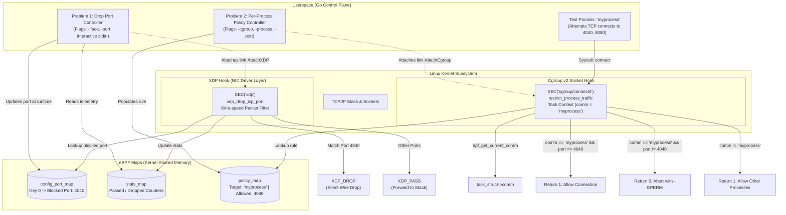

# AccuKnox Technical Assessment: eBPF & Golang Solutions

This repository contains complete, production-ready implementations and technical analyses for the AccuKnox engineering assessment covering **eBPF (Extended Berkeley Packet Filter)** kernel primitives and **Golang** concurrency.

---

## Architecture Overview



---

## Directory Structure

```text
.
├── Makefile                                # Unified build & test orchestration
├── Dockerfile                              # Complete Linux container environment
├── docker-compose.yml                      # Container test runner with BPF capabilities
├── go.mod                                  # Go module definitions (cilium/ebpf v0.17.3)
├── go.sum                                  # Cryptographic checksums
├── common/
│   └── bpf_headers/                        # Standalone, verifier-compliant BPF headers
│       ├── bpf_endian.h                    # Byte swapping macros (bpf_htons, bpf_ntohs)
│       ├── bpf_helpers.h                   # Helper prototypes & SEC macros
│       └── linux_types.h                   # Ethernet, IPv4, TCP header definitions
├── problem1-drop-port/                     # Problem 1: Drop packets using eBPF
│   ├── bpf/
│   │   └── xdp_drop_port.c                 # XDP eBPF program with userspace configurable port map
│   ├── main.go                             # Go loader (cilium/ebpf) with interactive port updates
│   └── test.sh                             # Automated test script (baseline vs blocked port)
├── problem2-process-filter/                # Problem 2: Drop packets only for a given process
│   ├── bpf/
│   │   └── cgroup_process_filter.c         # Cgroup sock_addr connect4 eBPF program
│   ├── main.go                             # Go loader & cgroup v2 attacher
│   ├── dummy_process/
│   │   └── main.go                         # Dummy binary compiled as "myprocess"
│   └── test.sh                             # Automated test script (isolated enforcement)
└── problem3-code-explanation/              # Problem 3: Go concurrency deep dive
    ├── buggy/
    │   └── main.go                         # Exact original code demonstrating race condition
    ├── fixed/
    │   └── main.go                         # Production-grade fixed code with sync.WaitGroup
    └── explanation.md                      # Exhaustive Q&A analysis
```

---

## Problem Statement 1: Drop Packets Using eBPF

### Objective
> "Write an eBPF code to drop the TCP packets on a port (def: 4040). Additionally, if you can make the port number configurable from the userspace, that will be a big plus."

### Architectural Choice: Why XDP?
Packet dropping can be implemented at multiple kernel hook points:
1. **XDP (`SEC("xdp")`) [Chosen]**: Runs at the lowest possible layer in the Linux network subsystem—directly in the network driver before any kernel memory allocation (`sk_buff`) occurs. Discarding packets via `XDP_DROP` yields unmatched line-rate performance and zero CPU overhead on the host network stack.
2. **TC (Traffic Control, `SEC("tc")`)**: Operates after `sk_buff` allocation. While versatile, it incurs packet allocation overhead.
3. **Iptables / Netfilter**: Traditional packet filtering requiring traversing user/kernel rule lists with high latency.

For dropping unauthorized packets or DDoS defense, **XDP is the industry standard** utilized by Cilium, Cloudflare, and AccuKnox.

### Kernel Space Implementation (`problem1-drop-port/bpf/xdp_drop_port.c`)
- **Map Definition**: Uses an eBPF Array Map (`config_port_map`) holding the target port.
  ```c
  struct {
      __uint(type, BPF_MAP_TYPE_ARRAY);
      __type(key, __u32);
      __type(value, __u32); // Port in host byte order (default: 4040)
      __uint(max_entries, 1);
  } config_port_map SEC(".maps");
  ```
- **Packet Parsing & Verifier Safety**:
  - Pointer bounds checking against `ctx->data_end` on every header access:
    ```c
    struct ethhdr *eth = data;
    if ((void *)(eth + 1) > data_end) return XDP_PASS;
    if (eth->h_proto != bpf_htons(ETH_P_IP)) return XDP_PASS;

    struct iphdr *iph = (void *)(eth + 1);
    if ((void *)(iph + 1) > data_end || iph->ihl < 5) return XDP_PASS;
    if (iph->protocol != IPPROTO_TCP) return XDP_PASS;

    struct tcphdr *tcph = (void *)iph + (iph->ihl * 4);
    if ((void *)(tcph + 1) > data_end) return XDP_PASS;
    ```
- **Port Comparison**:
  - Checks if `tcph->dest` or `tcph->source` matches `bpf_htons(target_port)`.
  - On match: updates `stats_map` and returns `XDP_DROP`.
  - Otherwise: updates `stats_map` and returns `XDP_PASS`.

### Userspace Implementation (`problem1-drop-port/main.go`)
- Developed in pure Go using `github.com/cilium/ebpf` and `github.com/cilium/ebpf/link`.
- **Dynamic Reconfiguration**: Users can update the blocked port **at runtime** either via command-line flags (`-port 4040`) or by typing a new port into stdin during execution—instantly updating `config_port_map` in the kernel without recompilation or reattachment!
- **Telemetry**: Periodically polls `stats_map` to report dropped packets, passed packets, and dropped bytes.
- **Graceful Shutdown**: Intercepts `SIGINT` / `SIGTERM` to safely detach the XDP hook from the interface.

### Running Problem 1
```bash
# 1. Compile eBPF bytecode and Go binary
make bpf && make go

# 2. Launch the dropper on loopback (default port 4040)
sudo ./problem1-drop-port/drop-port -iface lo -port 4040

# 3. In another terminal, test with netcat or curl:
# Start test servers
nc -lk -p 4040 &
nc -lk -p 8080 &

# Port 8080 connects immediately:
nc -zv 127.0.0.1 8080
# Connection to 127.0.0.1 8080 port [tcp/http-alt] succeeded!

# Port 4040 is dropped at driver level:
nc -zv -w 2 127.0.0.1 4040
# nc: connect to 127.0.0.1 port 4040 (tcp) timed out: Operation now in progress

# 4. Or execute the automated end-to-end test script:
sudo bash problem1-drop-port/test.sh
```

---

## Problem Statement 2: Drop Packets Only for a Given Process

### Objective
> "Write an eBPF code to allow traffic only at a specific TCP port (default 4040) for a given process name (for e.g, "myprocess"). All the traffic to all other ports for only that process should be dropped."

### The Core Architectural Dilemma
A common question in network security is: *Can XDP or TC ingress filter traffic based on a process name?*
- **No.** Packets arriving on the wire at the network driver (XDP/TC ingress) contain only network headers (IP, TCP/UDP). At this stage, the packet has not been processed by the TCP/IP stack or matched to a socket. **There is no `task_struct`, PID, or process command name (`comm`) in packet headers.**
- Similarly, at TC egress, packets transmitted via TCP retransmissions or deferred worker threads run in softirq context (`ksoftirqd`), where `current` does not point to the application process.

### The Solution: Cgroup Socket Address Hook (`cgroup/connect4`)
To enforce process-level network isolation, we must intercept the operation where **process context and network parameters intersect**: during socket connection establishment!
- **Hook**: `BPF_PROG_TYPE_CGROUP_SOCK_ADDR` with attach type `BPF_CGROUP_INET4_CONNECT` (`SEC("cgroup/connect4")`).
- **Context**: Executes synchronously in the context of the thread executing the `connect()` system call.
- **Process Identification**: The helper `bpf_get_current_comm(comm, sizeof(comm))` retrieves `current->comm` (the executable name).
- **Enforcement Logic**:
  1. Inspect `bpf_get_current_comm`.
  2. Compare with `policy.target_process` (e.g., `"myprocess"`).
  3. If process is **NOT** `"myprocess"`: return `1` (allow traffic unimpeded).
  4. If process **IS** `"myprocess"`:
     - Check `ctx->user_port`:
       - If `bpf_ntohs(ctx->user_port) == 4040` (allowed port): return `1` (allow connection).
       - If `bpf_ntohs(ctx->user_port) != 4040`: return `0` (drop/abort connection, returning `-EPERM`).

### Kernel Space Implementation (`problem2-process-filter/bpf/cgroup_process_filter.c`)
```c
SEC("cgroup/connect4")
int restrict_process_traffic(struct bpf_sock_addr *ctx) {
    if (ctx->type != 1 /* SOCK_STREAM */) return 1;

    __u32 key = 0;
    struct proc_policy *policy = bpf_map_lookup_elem(&policy_map, &key);
    if (!policy || !policy->enabled) return 1;

    char current_comm[TASK_COMM_LEN] = {0};
    if (bpf_get_current_comm(&current_comm, sizeof(current_comm)) < 0) return 1;

    if (is_same_comm(current_comm, policy->target_process)) {
        __u16 dest_port = bpf_ntohs((__u16)ctx->user_port);
        if (dest_port == (__u16)policy->allowed_port) {
            increment_stat(0); // Allowed
            return 1;
        }
        increment_stat(1); // Dropped
        return 0;          // Returns -EPERM to syscall
    }

    increment_stat(2); // Unaffected other processes
    return 1;
}
```

### Connection with AccuKnox & KubeArmor
AccuKnox's open-source runtime security engine, **KubeArmor**, uses a dual-primitive architecture:
1. **LSM Hooks (`lsm/socket_connect`, `lsm/socket_bind`)**: When Linux Security Modules with BPF are enabled (kernel >= 5.7), LSM provides system-wide security hooks with process and container context.
2. **Cgroup SockAddr (`cgroup/sock_addr`)**: The foundation of container network policies in Kubernetes cgroups (cgroup v2), allowing granular enforcement on individual Pods, microservices, and processes.

### Running Problem 2
```bash
# 1. Compile eBPF bytecode and Go binaries
make bpf && make go

# 2. Launch the per-process filter attached to cgroup v2
sudo ./problem2-process-filter/proc-filter -process myprocess -port 4040

# 3. In another terminal, run the test process binary:
./problem2-process-filter/myprocess

# Output:
# [myprocess] Running as binary name: "myprocess" (PID: 34102)
#
# --> Attempting TCP connection to 127.0.0.1:4040 (Permitted Port (4040))...
#     [✓] SUCCESS: Connected to 127.0.0.1:4040!
#
# --> Attempting TCP connection to 127.0.0.1:8080 (Unauthorized Port (8080))...
#     [-] FAILED to connect to 127.0.0.1:8080: dial tcp 127.0.0.1:8080: connect: operation not permitted
#
# --> Attempting TCP connection to 127.0.0.1:9090 (Unauthorized Port (9090))...
#     [-] FAILED to connect to 127.0.0.1:9090: dial tcp 127.0.0.1:9090: connect: operation not permitted

# 4. Verify that other processes (e.g. curl or nc) remain unaffected:
nc -zv 127.0.0.1 8080
# Connection to 127.0.0.1 8080 port [tcp/http-alt] succeeded!

# 5. Or run the automated test script:
sudo bash problem2-process-filter/test.sh
```

---

## Problem Statement 3: Code Snippet Explanation

### Provided Code
```go
package main

import "fmt"

func main() {
    cnp := make(chan func(), 10)

    for i := 0; i < 4; i++ {
        go func() {
            for f := range cnp {
                f()
            }
        }()
    }

    cnp <- func() {
        fmt.Println("HERE1")
    }

    fmt.Println("Hello")
}
```

### 1. What is the code attempting to do?
The code attempts to implement a concurrent **Worker Pool (Task Queue)** pattern:
- Creates a buffered queue of executable tasks (`cnp`).
- Spawns 4 background worker goroutines to continuously pull and execute tasks.
- Submits an anonymous task closure (`func() { fmt.Println("HERE1") }`) into the channel.
- Prints `"Hello"` from the main goroutine.

### 2. How do the highlighted constructs work?
- **`chan func()`**: Channels in Go can transmit any first-class type, including function values (`func()`). When a closure is received from the channel, invoking `f()` executes the encapsulated code within the worker goroutine, maintaining any lexical context captured when the task was created.
- **`make(chan func(), 10)`**: Instantiates a **buffered channel** with capacity 10. Sends to this channel are non-blocking as long as the buffer contains fewer than 10 unconsumed tasks.
- **`for i := 0; i < 4; i++ { go func() ... }`**: Spawns 4 persistent worker goroutines into the Go runtime scheduler. Each worker executes `for f := range cnp`, which blocks waiting for incoming functions until the channel is closed.
- **`cnp <- func() { ... }`**: Enqueues an anonymous closure into the channel buffer.

### 3. Use-cases for these constructs
- **Worker Pools & Concurrency Limiting**: Bounding the number of concurrent operations (e.g., database writes, HTTP crawlers, image encoding) to prevent system exhaustion.
- **AccuKnox / eBPF Telemetry Pipeline**: Processing kernel event streams (from eBPF ring buffers or perf events) across fixed worker goroutines to parse container metadata and evaluate security policies under high throughput.
- **Actor Model / Thread Confinement**: Serializing state modifications by sending `func()` closures to a single worker goroutine, eliminating race conditions without mutexes.

### 4. Significance of the `for` loop with 4 iterations
- Establishes a **concurrency ceiling of 4 workers**.
- Guarantees that at most 4 tasks will ever execute simultaneously, regardless of how many tasks are submitted.
- Prevents unbounded goroutine spawning (which can lead to memory exhaustion and thread thrashing).

### 5. Significance of `make(chan func(), 10)`
- The buffer capacity of **10** decouples the producer from the consumers.
- The producer can enqueue up to 10 tasks without blocking or waiting for an idle worker.
- **Crucial consequence in this snippet**: Because the buffer is empty and capacity is 10, the send operation `cnp <- func() { fmt.Println("HERE1") }` completes **instantly**. The main goroutine does not block and does not yield to the scheduler.

### 6. Why is “HERE1” not getting printed?
#### The Root Cause: Go Runtime Exit Race Condition
Under the Go Language Specification:
> *"When `main.main` returns, the program terminates immediately. It does not wait for other (non-main) goroutines to complete."*

#### Step-by-Step Execution Sequence:
1. `main` creates the buffered channel with capacity 10.
2. The `for` loop schedules 4 worker goroutines. Calling `go func()` registers goroutines in the scheduler's run queue (`runq`); **it does not execute them immediately**.
3. `main` sends the task to `cnp`. Because the channel has free buffer space (capacity 10), the closure is written into memory **without blocking**.
4. `main` immediately prints `"Hello"`.
5. `main` reaches the end of `func main()` and terminates the entire process (`runtime.exit(0)`).
6. **The program exits before the Go runtime scheduler ever context-switches to any of the 4 worker goroutines to dequeue and execute `f()`.**

#### Empirical Demonstration
Running the compiled binary without synchronization across 5 consecutive executions:
```text
Run 1: Hello | HERE1    (Worker won scheduler race)
Run 2: Hello            (HERE1 dropped!)
Run 3: Hello            (HERE1 dropped!)
Run 4: Hello | HERE1    (Worker won scheduler race)
Run 5: Hello            (HERE1 dropped!)
```

### 7. Fixed Idiomatic Implementation
The corrected code uses `sync.WaitGroup` to track task completion and worker termination:

```go
package main

import (
	"fmt"
	"sync"
)

func main() {
	cnp := make(chan func(), 10)
	var taskWg sync.WaitGroup
	var workerWg sync.WaitGroup

	const numWorkers = 4
	for i := 0; i < numWorkers; i++ {
		workerWg.Add(1)
		go func() {
			defer workerWg.Done()
			for f := range cnp {
				f()
			}
		}()
	}

	taskWg.Add(1)
	cnp <- func() {
		defer taskWg.Done()
		fmt.Println("HERE1")
	}

	fmt.Println("Hello")

	// Wait for task execution to finish
	taskWg.Wait()

	// Signal workers to terminate cleanly
	close(cnp)
	workerWg.Wait()
}
```
*Run verified: deterministically outputs `Hello` followed by `HERE1` 100% of the time with zero goroutine leaks.*

---

## Containerized Quickstart (Docker)

To run the entire suite in a privileged Linux environment with full kernel eBPF capabilities:

```bash
# 1. Build the Docker container
docker build -t accuknox-ebpf .

# 2. Run interactively with eBPF privileges
docker run --rm -it --privileged -v /sys/fs/cgroup:/sys/fs/cgroup:ro accuknox-ebpf

# 3. Inside the container, run automated tests:
make test-p1   # Runs Problem 1 XDP drop test
make test-p2   # Runs Problem 2 Per-Process cgroup test
make test-p3   # Runs Problem 3 concurrency comparison
```

---

## Technical Summary Matrix

| Metric | Problem 1: Packet Dropper | Problem 2: Per-Process Firewall | Problem 3: Concurrency |
| :--- | :--- | :--- | :--- |
| **Hook Type** | `SEC("xdp")` | `SEC("cgroup/connect4")` | Go Runtime Scheduler |
| **Execution Point** | NIC Driver (pre-`sk_buff`) | Syscall `connect()` (Task Context) | Userspace Goroutines |
| **Filtering Granularity** | Wire-level TCP Port | Process Name (`comm`) + Port | Channel Tasks |
| **Configurability** | Array Map via Userspace Go | Array Map via Userspace Go | Channel Buffer Size |
| **Verdict Mechanism** | `XDP_DROP` / `XDP_PASS` | Return `0` (`-EPERM`) / Return `1` | Synchronization via `sync.WaitGroup` |
| **AccuKnox Primitive** | Wire DDoS & Ingress Guard | Zero Trust Workload Isolation (KubeArmor) | High-throughput Event Dispatcher |

